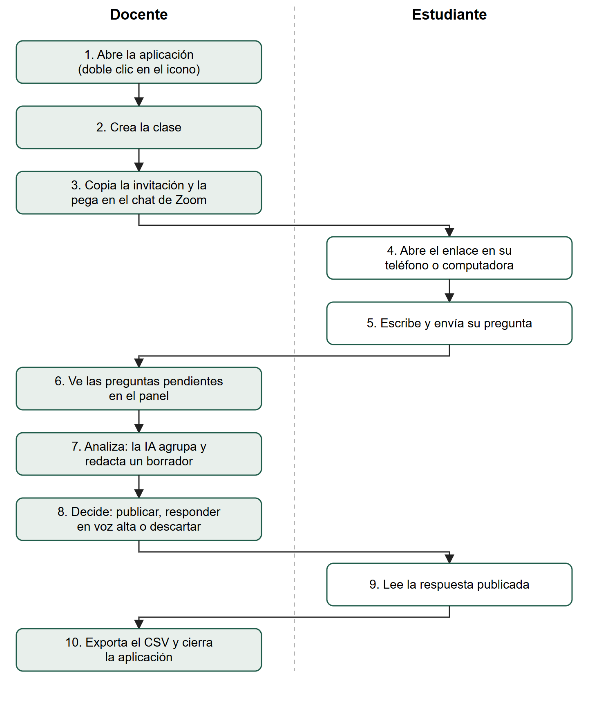
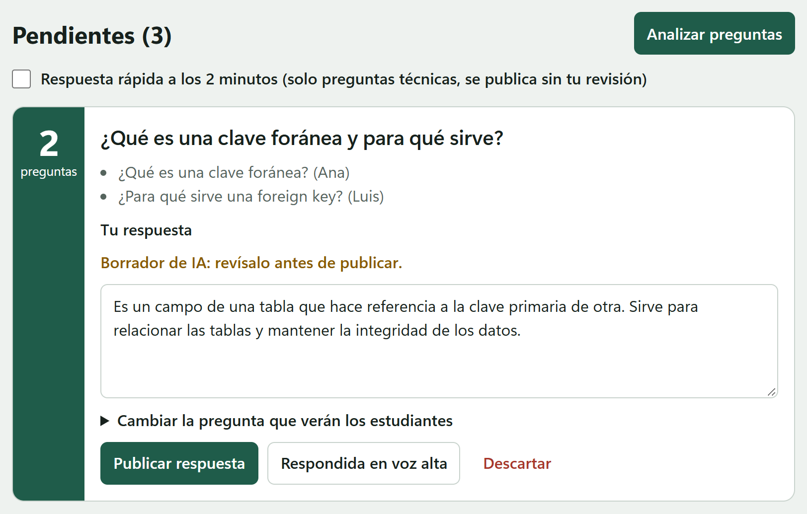

# Preguntas en vivo para clases por Zoom

Los estudiantes envían preguntas desde un enlace pegado en el chat de Zoom. El docente las ve en un panel, las agrupa con ayuda de Gemini y decide qué responder. La IA solo publica por sí sola si el docente activa la **respuesta rápida**.

Funciona con una cuenta gratuita de Zoom: no usa la API de Zoom.

## Documentación

Manual de usuario (formato APA 7): [PDF](manual/Manual_de_usuario.pdf) · [Word](manual/Manual_de_usuario.docx)





## Estructura

| Archivo | Contenido |
|---|---|
| `server.js` | Servidor, API y túnel público |
| `store.js` | Clases, preguntas, persistencia y exportación CSV |
| `gemini.js` | Agrupación y borradores con Gemini |
| `auto.js` | Respuesta rápida a los 2 minutos |
| `public/` | Página del estudiante y panel del docente |
| `test/` | Pruebas automáticas |

## Instalación (una sola vez)

1. [Node.js](https://nodejs.org) 24.2 o posterior. No hace falta `npm install`.
2. `cloudflared`, para que los estudiantes puedan entrar por internet:
   ```
   winget install --id Cloudflare.cloudflared
   ```
   Cierra y vuelve a abrir la terminal.
3. Copia `.env.example` como `.env` y pega tu clave de [Google AI Studio](https://aistudio.google.com/apikey) en `GEMINI_API_KEY`. Sin clave funciona todo menos **Analizar**.

## Uso en cada clase

1. Haz doble clic en **Preguntas en vivo** (acceso directo del escritorio) o en `Iniciar.cmd`. El panel se abre solo. Deja abierta la ventana negra.
2. Pulsa **Crear clase**; el tema es opcional.
3. Cuando diga **Enlace público listo**, pulsa **Copiar invitación** y pégala en el chat de Zoom.
4. La pestaña muestra cuántas preguntas hay pendientes. Pulsa **Analizar preguntas**, corrige el borrador y **Publicar respuesta**, o marca **Respondida en voz alta**.
5. Al terminar, **Exportar CSV** y cierra la ventana negra.

El enlace del panel (`/docente#…`) da control total: no lo compartas. Desde una terminal también funciona `npm start`.

Si compartes pantalla, recuerda que el panel muestra nombres y preguntas pendientes.

## Respuesta rápida

Se activa por clase con la casilla del panel y empieza apagada. Si una pregunta **técnica** sigue pendiente 2 minutos, la IA publica una respuesta con la etiqueta **Respuesta rápida**.

- **Yo respondo** detiene la cuenta; escribir en la tarjeta la reinicia.
- Las preguntas sobre fechas, notas, tareas o exámenes quedan para el docente.
- En **Atendidas**, **Corregir o retirar** quita la respuesta y deja su texto listo para editar.
- Se publica **sin revisión**: puede tener errores, la IA puede clasificar mal una pregunta y un estudiante podría redactarla para manipularla.
- La app debe estar abierta. No responde preguntas de hace más de 30 minutos y deja al menos 20 segundos entre consultas a Gemini.

## Ten en cuenta

- Solo para clases en las que **todos son mayores de 18 años**: los [términos de la API de Gemini](https://ai.google.dev/gemini-api/terms) lo exigen. Con menores, deja `GEMINI_API_KEY` vacía y revisa esos términos antes.
- En el nivel gratuito, Google puede usar el contenido para mejorar sus productos y personas pueden revisarlo. Se envían el título de la clase y el texto de las preguntas, no los nombres.
- La cuota gratuita es limitada; pulsa **Analizar** cuando haga falta, no tras cada pregunta.
- El enlace público cambia en cada arranque. El túnel gratuito es para pruebas y no garantiza disponibilidad.
- Máximo 10 envíos por minuto desde una misma red: si muchos estudiantes comparten conexión (un aula), pueden tener que esperar.
- Los datos quedan en `data/datos.json`. Para cambiar la clave del docente, borra `data/clave-docente.txt` y reinicia.
- Si Excel muestra todo en una columna, impórtalo desde **Datos > Desde texto/CSV** con coma como separador.

## Pruebas

```
npm test
```

Variables opcionales en `.env`: `PORT` (3000), `GEMINI_MODEL`, `SIN_TUNEL=1` para usarlo solo en este equipo.
