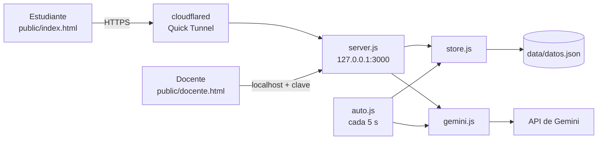

# Guía para desarrolladores

Cómo está hecha **Preguntas en vivo** y cómo cambiarla sin romperla. Para usarla, lee el [manual de usuario](../manual/Manual_de_usuario.pdf); para instalarla, el [README](../README.md).

## Empezar

Necesitas Node.js 24.2 o posterior. No hay dependencias de npm ni paso de compilación.

```bash
git clone https://github.com/CesarLoor/bot-zoon.git
cd bot-zoon
cp .env.example .env      # en PowerShell: Copy-Item .env.example .env
npm test
npm start
```

`npm start` imprime el enlace del panel (`http://localhost:3000/docente#<clave>`). Para trabajar sin exponer nada a internet, añade `SIN_TUNEL=1` a `.env`.

| Variable | Valor por defecto | Para qué |
|---|---|---|
| `GEMINI_API_KEY` | vacía | Análisis y respuesta rápida. Sin ella, lo demás funciona |
| `GEMINI_MODEL` | `gemini-3.5-flash-lite` | Modelo de Gemini |
| `PORT` | `3000` | Puerto local |
| `SIN_TUNEL` | sin definir | Cualquier valor: no inicia cloudflared |
| `ABRIR_PANEL` | sin definir | Cualquier valor: abre el panel en el navegador (Windows). La define `Iniciar.cmd` |

Los cambios en `public/` se ven al recargar la página. Los cambios en los `.js` del servidor requieren reiniciar.

## Arquitectura



| Archivo | Responsabilidad |
|---|---|
| `server.js` | Rutas HTTP, autenticación, límites, túnel, arranque y temporizador |
| `store.js` | Datos, validación, estados, vista pública, CSV y `dueAt` (cuándo vence una pregunta) |
| `gemini.js` | Una llamada a Gemini y validación de lo que devuelve |
| `auto.js` | Decide qué publicar como respuesta rápida |
| `public/` | Dos páginas autónomas (HTML, CSS y JavaScript en el mismo archivo) |
| `Iniciar.cmd` | Arranque con doble clic en Windows |
| `test/` | Pruebas con `node:test` |

### Decisiones y motivos

| Decisión | Motivo | Consecuencia |
|---|---|---|
| Página web aparte, sin API de Zoom | Debe funcionar con una cuenta gratuita | El docente pega el enlace en el chat |
| Sin dependencias de npm | Instalar y mantener es más simple | HTTP, pruebas y CSV usan solo Node |
| Consulta cada 3 s | Quick Tunnels no admite Server-Sent Events | No hay avisos instantáneos |
| Datos en un archivo JSON | Un solo docente y pocas preguntas | Un solo proceso puede escribirlo |
| Temporizador en el servidor | El navegador frena las pestañas ocultas | La respuesta rápida no depende del panel |

## Datos

`data/datos.json` se crea solo. Cada cambio se escribe en un archivo temporal y se renombra; la memoria se actualiza únicamente si la escritura funcionó. Si el archivo está dañado, la app falla al arrancar y no lo sobrescribe. No lo edites con la app abierta.

```json
{
  "clases": [{
    "codigo": "aB3dE9xQ",
    "titulo": "Bases de datos",
    "creada": "2026-11-25T20:00:00.000Z",
    "autoDesde": 1795636800000,
    "preguntas": [{
      "id": "uuid",
      "texto": "¿Qué es una clave foránea?",
      "nombre": "",
      "creada": "2026-11-25T20:01:00.000Z",
      "estado": "publicada",
      "grupo": { "id": "uuid", "resumen": "…", "sugerencia": "…", "tecnica": true },
      "publicacion": { "id": "uuid", "enunciado": "…", "respuesta": "…", "rapida": true },
      "aplazada": null,
      "sinIA": null
    }]
  }]
}
```

| Campo | Significado |
|---|---|
| `autoDesde` | Momento (ms) en que se activó la respuesta rápida; ausente o `null` si está apagada |
| `estado` | `pendiente`, `publicada`, `oral` o `descartada` |
| `grupo` | Resultado del último análisis; las preguntas de un grupo lo comparten |
| `publicacion` | Solo en publicadas. Las preguntas con el mismo `id` muestran una sola respuesta |
| `rapida` | Existe solo si la publicó la respuesta rápida |
| `aplazada` | Momento (ms) desde el que vuelve a contar el plazo |
| `sinIA` | Por qué no se responderá sola: `docente`, `no-tecnica` o `sin-respuesta` |

Límites: pregunta y enunciado 500 caracteres, nombre 60, título 120, respuesta 3000, 500 preguntas por clase.

**Compatibilidad:** quien actualiza conserva su `data/`. Un campo nuevo puede faltar en datos antiguos, así que el código debe tolerarlo (por ejemplo, `auto.js` vuelve a consultar los grupos sin `tecnica`).

## API

Entrada y salida en JSON, salvo el CSV. Los errores tienen la forma `{ "error": "mensaje para el usuario" }`.

### Estudiante (sin clave)

| Método y ruta | Cuerpo | Respuesta |
|---|---|---|
| `GET /api/clase/:codigo` | | `{ titulo, respuestas: [{ enunciado, respuesta, rapida? }] }` |
| `POST /api/clase/:codigo/preguntas` | `{ texto, nombre? }` (máx. 4 KB) | `201 { ok: true }` |

Máximo 10 envíos por minuto por IP (`cf-connecting-ip`, o la dirección de la conexión).

### Docente (`Authorization: Bearer <clave>`)

La clave está en `data/clave-docente.txt`. Todas las rutas empiezan por `/api/docente/clases`.

| Método y ruta | Cuerpo | Respuesta |
|---|---|---|
| `GET` (raíz) | | `{ clases: [{ codigo, titulo, creada }] }` |
| `POST` (raíz) | `{ titulo }` | `201` con la clase creada |
| `GET /:codigo` | | La clase, más `enlace`, `avisoAuto` y `restante` (ms o `null`) por pregunta |
| `POST /:codigo/preguntas` | `{ ids, estado, enunciado?, respuesta? }` | `{ ok: true }`. Publicar exige enunciado y respuesta |
| `POST /:codigo/analizar` | | `{ grupos: n }` |
| `POST /:codigo/auto` | `{ activo: true o false }` | `{ ok: true }` |
| `POST /:codigo/posponer` | `{ ids }` | `{ ok: true }`. Reinicia el plazo |
| `POST /:codigo/retener` | `{ ids }` | `{ ok: true }`. La responde el docente |
| `GET /:codigo/csv` | | Archivo CSV |

| Código | Causa |
|---|---|
| 400 | Datos no válidos |
| 401 | Clave de docente incorrecta |
| 404 | Ruta o clase inexistente |
| 413 | Cuerpo demasiado grande |
| 429 | Demasiados envíos, clase llena o cuota de Gemini agotada |
| 502 / 503 | Gemini no responde, está saturado o falta la clave |
| 500 | Error interno; el detalle sale en la consola |

## Respuesta rápida

`server.js` llama a `auto.tick()` cada 5 segundos. Una pregunta vence cuando está pendiente, su clase tiene `autoDesde`, no tiene `sinIA`, llegó hace 30 minutos o menos y pasaron 2 minutos desde lo último entre: su llegada, la activación o un aplazamiento.

1. Los grupos ya analizados y clasificados se resuelven con su borrador, sin otra consulta. Si vence una pregunta del grupo, entran las demás que sigan esperando.
2. Las preguntas restantes vencidas van juntas en una sola consulta.
3. Al volver la respuesta se **relee** la clase: si el docente actuó entretanto, no se publica.
4. Lo no técnico, vacío u omitido queda marcado en `sinIA` y no se consulta de nuevo.
5. Entre consultas pasan al menos 20 s; tras un error, 60 s. Esa espera y el aviso son comunes a todas las clases.

Una pregunta reabierta queda con `sinIA: "docente"`, para que la respuesta retirada no vuelva sola. Los tiempos son `WAIT_MS` y `STALE_MS` en `store.js`, y `GAP_MS` y `RETRY_MS` en `auto.js`. El texto "2 minutos" también está escrito en `public/docente.html`, el README y el manual.

## Gemini

`gemini.js` usa `POST https://generativelanguage.googleapis.com/v1beta/interactions` con las cabeceras `x-goog-api-key` y `api-revision`, `store: false` y un esquema JSON obligatorio: `grupos[{ ids, resumen, sugerencia, tecnica }]`.

- Se envían el título de la clase y el texto de las preguntas, numeradas. Nunca los nombres.
- Lo que devuelve el modelo no es de fiar: se descartan los `ids` inventados o repetidos y los grupos mal formados, se recortan los textos y `tecnica` solo cuenta si es exactamente `true`.
- Los [términos de la API](https://ai.google.dev/gemini-api/terms) exigen que los usuarios sean mayores de 18 años.

## Seguridad: no lo rompas

La dirección del túnel es pública y las preguntas son texto de desconocidos.

- Toda ruta nueva del docente va bajo `/api/docente/`, donde se comprueba la clave. No confíes en que una petición venga de `localhost`: las del túnel también llegan así.
- Muestra texto de usuarios o de la IA solo con `textContent`, nunca con `innerHTML`.
- Valida en `store.js` todo lo que llegue en una petición. `rapida` no puede venir del cuerpo.
- El estudiante recibe únicamente `publicView`: nada de pendientes, nombres ni borradores.
- Solo se sirven los archivos listados en `PAGES`.
- El CSV antepone `'` a las celdas que una hoja de cálculo ejecutaría como fórmula.
- Nunca subas `.env`, `data/` ni archivos `.csv` (ya están en `.gitignore`).

**Riesgo conocido:** un estudiante puede redactar su pregunta para manipular a la IA, y la respuesta rápida se publica sin revisión. El prompt lo mitiga, pero no lo impide.

## Pruebas

```bash
npm test
node --test test/auto.test.js   # un solo archivo
```

`createApp({ store, teacherKey, analyze, publicUrl, now })` permite sustituir Gemini y el reloj, y `server.auto.tick()` ejecuta la respuesta rápida a mano. Las pruebas usan archivos temporales y no llaman a Gemini.

Las páginas de `public/` no tienen pruebas automáticas: compruébalas en un navegador. Antes de cambiar una regla, escribe la prueba que falla.

## Carpeta portátil (Windows x64)

Un ZIP que funciona sin instalar nada:

1. En una carpeta vacía copia `server.js`, `store.js`, `gemini.js`, `auto.js`, `package.json`, `Iniciar.cmd`, `public/` y `manual/Manual_de_usuario.pdf`.
2. Copia `.env.example` como `.env`, **con la clave vacía**.
3. Crea `bin\` con `node.exe` (y su licencia) y `cloudflared.exe`, descargados de sus sitios oficiales. `Iniciar.cmd` añade `bin\` al `PATH`.
4. Añade un archivo de instrucciones y comprime la carpeta.

Copia por lista, nunca la carpeta del proyecto entera: así no viajan tu `.env` ni `data/`. Pruébalo en una computadora sin Node.

## Detalles que sorprenden

- `Iniciar.cmd` debe seguir en ASCII y con finales de línea CRLF.
- Si la app ya está abierta, un segundo doble clic solo abre el panel; para cargar código nuevo hay que cerrar la ventana negra.
- `isThisApp` reconoce la app por el `<title>` de `public/index.html`. Si lo cambias, cambia también esa función.
- El panel guarda la clave en `localStorage` y la borra de la barra de direcciones.
- El panel no mueve las tarjetas existentes, para no interrumpir a quien escribe.
- El enlace público cambia en cada arranque.

## Contribuir

Haz un fork, crea una rama, deja `npm test` en verde y abre un pull request. Los mensajes de commit van en español. Si cambia lo que ve el usuario, actualiza el README y el manual; el manual se edita en el `.docx` y se exporta a PDF (sin nombres personales en sus propiedades).

## Limitaciones y trabajo pendiente

- Un solo docente por instalación, en su propia computadora.
- Quick Tunnels es para pruebas y no garantiza disponibilidad.
- El límite por IP puede afectar a estudiantes que comparten red.
- `Iniciar.cmd` y la apertura automática del panel son solo para Windows.
- La carpeta portátil se arma a mano.
- El repositorio aún no declara una licencia: pide permiso a su autor antes de reutilizar el código.
